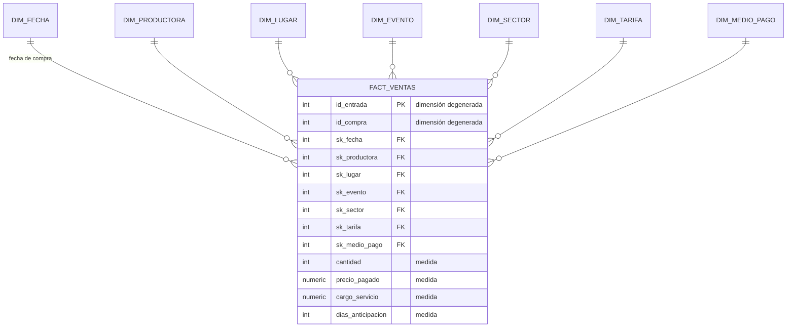

# Backstage — Data warehouse (coloquio de Base de Datos)

Guía para armar, entender y defender el data warehouse. Todos los integrantes tienen que poder explicar cada sección.
Los scripts están en [api-eventos/database/dw/](../../api-eventos/database/dw/).

## Consigna

1. Elegir un proceso de negocio y 3 o 4 preguntas que el DW tiene que responder
2. Definir el grano, las dimensiones y las medidas
3. Crear las tablas de dimensiones y la tabla de hechos
4. Cargar los datos (primero dimensiones, después hechos)
5. Verificar los totales contra la base operativa y responder las preguntas con consultas
6. Guardar la carga en un procedimiento almacenado para poder repetirla

Son dos bases de datos en el mismo servidor (la operativa y la del DW) y la migración se hace con `INSERT` desde la operativa hacia el DW.

---

## 1. Qué es un data warehouse y para qué sirve

La **base operativa** (`backstage`) es la que usa la aplicación. Está pensada para **registrar**: cada compra es un `INSERT` chico,
está normalizada (cada dato está en un solo lugar) y responde bien preguntas puntuales como "¿qué entradas tiene esta compra?".

El **data warehouse** (`backstage_dw`) está pensado para **analizar**. Responde preguntas sobre muchos datos juntos,
como "¿cuánto recaudó cada productora por mes en dos años?". Para eso:

- **Se separa de la operativa.** Las consultas pesadas no frenan las ventas que están entrando.
- **Se reorganiza alrededor de un hecho** (la venta) y de los ejes desde los que se lo mira (cuándo, qué evento, qué sector, cómo se pagó). Es el modelo estrella.
- **Está desnormalizado a propósito.** Repite datos para necesitar menos JOIN. En la operativa eso traería inconsistencias, pero en el DW nadie escribe: solo lo llena la carga.
- **Los datos llegan limpios y calculados.** Solo compras pagadas, el cargo por servicio repartido por entrada, los días de anticipación ya calculados.

| | Base operativa (OLTP) | Data warehouse (OLAP) |
|---|---|---|
| Para qué | Registrar la operación del día a día | Analizar y tomar decisiones |
| Quién escribe | La aplicación, todo el tiempo | Solo el procedimiento de carga |
| Diseño | Normalizado (3FN) | Estrella, desnormalizado |
| Consultas típicas | Pocas filas, por id | Miles de filas, agrupadas y sumadas |

---

## 2. Dónde vive cada cosa

```
PostgreSQL 18 (servicio de Windows, localhost:5432)  ← el SERVIDOR
├── backstage      ← base operativa: las tablas de la app + datos ficticios
└── backstage_dw   ← base del DW: dimensiones, fact_ventas, procedimiento cargar_dw()
        └── esquema origen: "tablas foráneas" que apuntan a las tablas de backstage (postgres_fdw)

pgAdmin ──► se conecta al servidor y muestra las dos bases (es solo la ventana para mirar)
```

**Cómo se comunican las dos bases.** Dos bases de un mismo servidor no se ven entre sí: desde `backstage_dw` no se puede escribir
`SELECT * FROM backstage.compras`. Para eso se usa **`postgres_fdw`** (Foreign Data Wrapper), una extensión que viene con PostgreSQL.
Se configura una vez ([03_conexion_origen.sql](../../api-eventos/database/dw/03_conexion_origen.sql)):

1. `CREATE SERVER operativa`: dónde está la otra base (localhost, puerto 5432, base `backstage`).
2. `CREATE USER MAPPING`: con qué usuario y contraseña se entra.
3. `IMPORT FOREIGN SCHEMA`: crea en el esquema `origen` una tabla foránea por cada tabla que se pide.

Las tablas de `origen` **no guardan datos**: cada vez que se consultan, Postgres los va a buscar a `backstage`.
Por eso la carga es un `INSERT INTO dim_... SELECT ... FROM origen.<tabla>`, que es lo que pide la consigna.

Solo se importan las tablas que el DW necesita. `usuarios` no se importa: el DW no necesita emails, DNI ni contraseñas.

Dos detalles de la configuración:
- **Se entra con el usuario `postgres`.** Las tablas de la operativa tienen RLS activado sin políticas (para que la API pública de Supabase no las exponga): un usuario común vería 0 filas, y el superusuario saltea RLS.
- **`fetch_size '10000'`.** Es cuántas filas trae `postgres_fdw` por viaje. El valor por defecto es 100: para 130.000 entradas serían 1.300 idas y vueltas entre las bases.

> **No usamos Supabase ni Docker.** Supabase es la base del sitio publicado (no se llena con datos de prueba) y cada proyecto trae una sola base.
> Todo corre en el PostgreSQL instalado en Windows.

---

## 3. El diseño

### 3.1 Proceso de negocio y preguntas

**Proceso:** la **venta de entradas**. Es el proceso central de Backstage y el que más datos genera.

| # | Pregunta | Para quién sirve |
|---|---|---|
| 1 | ¿Cuánto recauda cada productora por mes, y cuánto cobra la plataforma en cargo por servicio? | Productoras y dueños de la plataforma |
| 2 | ¿Qué sectores y tarifas venden más en cada evento? | Productoras: precios y armado de sectores |
| 3 | ¿Con cuánta anticipación compra la gente? | Productoras: cuándo abrir la preventa y cuándo hacer publicidad |
| 4 | ¿Qué medios de pago se usan, por productora y por tipo de lugar? | Plataforma: acuerdos con procesadores de pago |

### 3.2 Grano

> **Una fila de `fact_ventas` = una entrada vendida en una compra pagada.**

Es el nivel más fino que existe en la operativa. Con un grano fino se puede sumar hacia arriba (por compra, por evento, por mes),
pero con uno grueso no se puede bajar. Si el grano fuera "una compra", no se podría saber cuántas entradas se vendieron por sector,
porque el sector está en la tarifa de cada entrada.

### 3.3 Modelo estrella



En pgAdmin se ve el diagrama real: clic derecho en `backstage_dw` → **ERD For Database**.

### 3.4 Dimensiones

Cada dimensión es un **eje para mirar las ventas**: lo que va después del "por" en una pregunta ("recaudación **por** productora **por** mes").

| Dimensión | Atributos | Sale de |
|---|---|---|
| `dim_fecha` | fecha, año, trimestre, mes, nombre del mes, año-mes, día, día de la semana, fin de semana | Se genera con `generate_series` |
| `dim_productora` | nombre, CUIT, % de cargo por servicio | `empresas` |
| `dim_lugar` | nombre, tipo (estadio, arena, teatro…), ciudad, provincia, si es propio | `lugares` |
| `dim_evento` | nombre, tipo (recital o festival), fechas, estado | `eventos` |
| `dim_sector` | nombre (Campo, Platea…), lugar, modalidad, capacidad | `espacios` + `lugares` |
| `dim_tarifa` | nombre (Preventa, General…), si es abono, precio de lista | `tarifas` |
| `dim_medio_pago` | código y nombre (crédito, débito, transferencia) | `compras.medio_pago` |

**`dim_fecha` no sale de la operativa.** Se genera un día por fila para todos los años con datos. Así se agrupa por mes, trimestre
o día de la semana sin calcular nada en cada consulta. Su clave es la fecha como número `AAAAMMDD` (20261118): se lee a simple vista
y la carga la calcula sin buscar en la tabla.

### 3.5 Medidas

Son los **números que se suman**: lo que va antes del "por" ("**recaudación** por productora").

| Medida | Qué es | Cómo se obtiene |
|---|---|---|
| `cantidad` | Siempre 1 | `SUM(cantidad)` = entradas vendidas |
| `precio_pagado` | Lo que cobra la productora por la entrada | `entradas.precio_pagado` |
| `cargo_servicio` | La parte del cargo de la compra que le toca a esta entrada (lo cobra la plataforma) | Cargo de la compra repartido entre sus entradas |
| `dias_anticipacion` | Cuántos días antes del evento se compró | Fecha del evento − fecha de compra |

### 3.6 Decisiones que hay que saber explicar

- **Claves sustitutas (`sk_`).** Las genera el DW con `SERIAL` y no dependen de los ids de la operativa. Si mañana los datos vinieran de otro sistema con otros ids, el DW no cambia. También permiten guardar historia: varias versiones de una misma productora, cada una con su `sk_`. Cada dimensión guarda además el id original (`id_evento`, `id_lugar`…) para poder cruzar durante la carga.
- **Dimensión degenerada.** `id_entrada` e `id_compra` están en la tabla de hechos sin tabla de dimensión propia: no tienen atributos para describir. `id_compra` sirve para contar compras con `COUNT(DISTINCT id_compra)`. Es necesario porque el grano es la entrada y una compra de 4 entradas es un solo pago.
- **Reparto del cargo por servicio.** En la operativa el cargo está en la compra, no en cada entrada. Si una compra de 3 entradas tiene $100,01 de cargo, cada entrada lleva $33,33 y los $0,02 que sobran van a la primera. Así la suma del DW da exacto la de la operativa.
- **Solo compras pagadas.** Las rechazadas y canceladas no son ventas. Las filtra la carga: quien consulta el DW no tiene que acordarse.
- **Productora y lugar como dimensiones propias.** Se podrían guardar dentro de `dim_evento`. Se separan porque son ejes de análisis por sí mismos (pregunta 1 y 4) y así la consulta es directa.

---

## 4. La carga (ETL)

ETL = **E**xtract (leer de la operativa), **T**ransform (filtrar, calcular), **L**oad (insertar en el DW).
Está en el procedimiento `cargar_dw()` ([05_procedimiento_carga.sql](../../api-eventos/database/dw/05_procedimiento_carga.sql)) y se corre con:

```sql
CALL cargar_dw();
```

Qué hace, en orden:

1. **Prepara y vacía el DW.** Quita las claves foráneas y los índices de `fact_ventas` y vacía todo con `TRUNCATE ... RESTART IDENTITY`: las `sk_` vuelven a empezar en 1.
2. **Carga las dimensiones**: un `INSERT ... SELECT ... FROM origen.<tabla>` por cada una. `dim_fecha` se genera.
3. **Carga los hechos**: lee entradas + compras + tarifas + eventos de `origen`, filtra las pagadas, reparte el cargo y calcula los días de anticipación. Después busca la `sk_` de cada dimensión con un JOIN por el id original.
4. **Recrea las claves foráneas y los índices** de `fact_ventas`.
5. **Deja una fila en `carga_log`** con la hora y la cantidad de filas cargadas.

**¿Por qué quita y recrea las claves foráneas?** Con las claves puestas, Postgres controla cada venta una por una
(130.000 filas × 7 claves) y la carga tardaba 37 segundos. Al recrearlas, valida todas las filas juntas en una sola pasada: tarda unos 10 segundos.
Es la técnica habitual en cargas masivas. La integridad se controla igual: si una venta apuntara a una dimensión que no existe, el `ADD CONSTRAINT` falla y se deshace toda la carga.

**¿Por qué primero las dimensiones?** Porque `fact_ventas` tiene claves foráneas a las dimensiones: para insertar una venta, la `sk_` del evento, del sector, etc. ya tiene que existir.

**¿Por qué recarga completa?** Es simple y se puede repetir: corriéndolo dos veces se obtiene lo mismo, sin duplicados. Con nuestro volumen tarda segundos.
Con millones de filas convendría una **carga incremental**: traer solo las entradas con `id_entrada` mayor a la última cargada.

**¿Y si falla a mitad de camino?** Todo el `CALL` es una transacción: si algo falla, se deshace entero y el DW queda como estaba.

---

## 5. Los datos ficticios

Los seeds de la app traen 3 eventos y 7 compras: con eso ninguna consulta muestra nada interesante.
[01_datos_ficticios.sql](../../api-eventos/database/dw/01_datos_ficticios.sql) llena la operativa con:

- 4 productoras más (7 en total) y 1.500 clientes
- 36 recitales ya realizados, uno cada 17 días entre marzo de 2025 y noviembre de 2026, en 10 lugares de la plataforma
- dos tarifas por sector: Preventa (de 90 a 30 días antes, 20 % más barata) y General (el último mes)
- compras de 1 a 4 entradas: cada recital tiene una ocupación al azar entre 35 % y 100 %, y ~1 de cada 8 se agota
- la mayoría de la gente compra cerca de la fecha: en los teatros con más anticipación y en los clubes a último momento
- cada productora tiene su propia proporción de medios de pago, y ~7 % de las compras queda rechazada o cancelada

En total: **59.226 compras (55.523 pagadas) y 129.461 entradas**.

Usa `generate_series` y `random()`, con `setseed(0.42)`: si todos lo corren en una base nueva, obtienen los mismos números.
Se insertan **en la base operativa**, respetando sus claves foráneas, CHECK y triggers, como si las hubiera hecho la aplicación.

### Números de referencia

Si armaste todo de cero, la verificación (`06_verificacion.sql`) te tiene que dar exactamente esto:

| Control | Valor |
|---|---|
| Entradas vendidas | 129.461 |
| Compras pagadas | 55.523 |
| Recaudación de las productoras | $6.555.126.000,00 |
| Cargo por servicio (plataforma) | $690.963.550,00 |

Algunos resultados de las consultas para tener a mano en la defensa:
- **Pregunta 1:** Eventos del Centro es la que más recauda ($1.327 millones). La plataforma cobró $691 millones en cargo por servicio.
- **Pregunta 2:** el 60 % de las entradas se vende con tarifa General y el 40 % en Preventa.
- **Pregunta 3:** el 13,6 % compra el mismo día del evento y el 33 % en la última semana. En los teatros la mediana de anticipación es de 39 días; en los clubes, de 6.
- **Pregunta 4:** en general predomina la tarjeta de crédito (de 47 % a 68 % según la productora), salvo en Cumbre Producciones, donde el medio más usado es la transferencia (37 %).

---

## 6. Cómo armarlo en tu PC

La defensa se hace desde **una sola PC**, que ya tiene las dos bases armadas. Los demás no necesitan instalar nada; esta sección es por si alguien quiere probarlo en la suya.

Requisito: PostgreSQL instalado en Windows (con pgAdmin). `postgres_fdw`, `pgcrypto` y `btree_gist` vienen incluidas.

### Opción A — Todo de una (recomendada)

En PowerShell, en la carpeta `api-eventos\database\dw`:

```powershell
powershell -ExecutionPolicy Bypass -File .\ejecutar_todo.ps1
```

Pide la contraseña de `postgres`, crea las dos bases, corre todos los scripts, hace la carga y muestra la verificación.
Si las bases ya existen, se agrega `-Recrear` para borrarlas y empezar de cero. Si la versión de PostgreSQL no es la 18, se agrega `-Version 17` (o la que sea).

### Opción B — A mano en pgAdmin (para entender cada paso)

1. Clic derecho en *Databases* → *Create* → *Database* → `backstage`.
2. *Query Tool* sobre `backstage` → abrir y correr (F5), en orden, los scripts `01` a `12` de `api-eventos/database/` (el `00_reset` no hace falta).
3. En la misma base, correr `dw/01_datos_ficticios.sql`. Al final muestra cuántas filas quedaron.
4. Crear la base `backstage_dw` (a mano o con `dw/02_crear_base_dw.sql`).
5. *Query Tool* sobre `backstage_dw` → abrir `dw/03_conexion_origen.sql`, **reemplazar `CAMBIAR_POR_TU_CLAVE` por tu contraseña** y correrlo. Al final tiene que mostrar 5 eventos: eso confirma que las bases se comunican.
6. Correr `dw/04_tablas_dw.sql` y `dw/05_procedimiento_carga.sql`.
7. `CALL cargar_dw();`
8. Correr `dw/06_verificacion.sql`: todas las diferencias en 0.
9. Abrir `dw/07_consultas.sql` y correr cada consulta seleccionándola con el mouse + F5.

---

## 7. Guion para la defensa

1. **El problema.** Mostrar en `backstage` las tablas operativas y la pregunta 1 hecha directo ahí (está comentada al final de `07_consultas.sql`): 4 tablas, hay que saber dónde está cada dato y acordarse de filtrar las pagadas.
2. **Las dos bases.** En pgAdmin, las dos bases en el mismo servidor. En `backstage_dw`: `SELECT * FROM origen.compras LIMIT 10;` → "esto lo leo de la otra base, por postgres_fdw".
3. **El diseño.** ERD de `backstage_dw`: proceso, grano, dimensiones, medidas (sección 3).
4. **La carga.** Abrir el procedimiento y explicar el orden. `CALL cargar_dw();`. Correrlo otra vez y mostrar que `carga_log` tiene dos filas y los totales no cambiaron.
5. **La verificación.** `06_verificacion.sql`: diferencias en 0.
6. **Las preguntas.** Las 4 consultas de `07_consultas.sql`. En pgAdmin, el botón de gráfico de la grilla de resultados (*Graph Visualiser*) arma un gráfico de barras o de líneas, por ejemplo con la pregunta 3.

---

## 8. Preguntas probables del coloquio

**¿Qué es el grano y por qué elegiste ese?**
Es qué representa una fila de la tabla de hechos. Elegimos una entrada vendida porque es el nivel más fino: se puede sumar a cualquier nivel más alto. Con grano "compra" no se podría analizar por sector.

**¿Qué diferencia hay entre una dimensión y una medida?**
La medida es un número que se suma (recaudación, entradas). La dimensión es desde dónde se mira y por qué se agrupa (productora, mes, sector).

**¿Por qué no consultar directo la base operativa?**
Por rendimiento: las consultas pesadas compiten con las ventas. Por simplicidad: en el DW los datos ya están filtrados y calculados. Y por historia: el DW puede guardar datos que la operativa borra o modifica.

**¿Por qué las dimensiones están desnormalizadas? ¿No es un error de diseño?**
En la operativa sí lo sería, porque al actualizar un dato habría que hacerlo en varios lugares. En el DW nadie actualiza: solo lo llena la carga. Se gana en consultas más simples, con menos JOIN.

**¿Para qué sirven las claves sustitutas si ya tengo los ids?**
Para no depender del sistema de origen y para poder guardar varias versiones de una misma entidad (dimensiones lentamente cambiantes, tipo 2).

**¿Qué es una dimensión degenerada?**
Un identificador que queda en la tabla de hechos sin tabla propia porque no tiene atributos para describir. En nuestro caso `id_entrada` e `id_compra`.

**¿Cómo se comunican las dos bases?**
Con la extensión `postgres_fdw`. Se define el servidor remoto, el usuario con el que se entra y se importan las tablas como tablas foráneas en el esquema `origen`. No son copias: cada consulta va a buscar los datos a la otra base.

**¿Por qué primero las dimensiones y después los hechos?**
Por las claves foráneas: la venta tiene que apuntar a la `sk_` del evento, del sector, etc., que ya tienen que existir.

**¿Por qué el procedimiento quita las claves foráneas antes de cargar? ¿No se pierde integridad?**
No: se recrean al final, y al recrearlas Postgres valida todas las filas. Si alguna fallara, se deshace toda la carga. Se hace porque validar 130.000 filas juntas es mucho más rápido que validarlas una por una mientras se insertan (de 37 a 10 segundos).

**¿Qué pasa si corro la carga dos veces?**
Lo mismo: el procedimiento empieza vaciando el DW con `TRUNCATE`, así que no se duplica nada. `carga_log` muestra cada ejecución.

**¿Cómo sabés que la carga está bien?**
Con `06_verificacion.sql`: cantidad de entradas, compras, recaudación y cargo por servicio, en total y por productora, comparados contra la operativa y contra la vista `v_recaudacion` que usa la app. Las diferencias dan 0.

**¿Qué mejorarías?**
Carga incremental en vez de completa; dimensión cliente cuando el registro pida provincia y fecha de nacimiento; historia de la productora (tipo 2) si cambia su porcentaje de cargo; programar la carga para que corra sola todas las noches.
